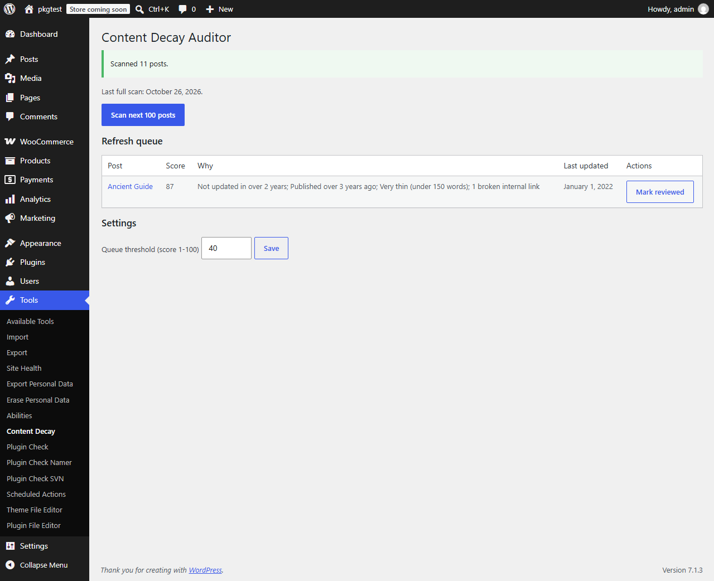

# Content Decay Auditor

Finds old, thin or stale posts and builds a prioritised refresh queue, with one-click "mark reviewed". No external services.

   



## Features
- Decay score 0-100 from last update, age, word count and broken internal links.
- Ranked refresh queue above a configurable threshold.
- One-click **Mark reviewed**: counts as an update for scoring, without touching the post.
- Batch scanning (100 posts per run) that resumes where it stopped, weekly via WP-Cron or on demand.
- WP-CLI: `wp decay scan`, `wp decay report`, `wp decay review <id>`.
- Nothing runs on the front end.

## Installation
**Zip:** download the release zip, then Plugins > Add New > Upload. **Manual:** copy `content-decay-auditor` to `wp-content/plugins/`.

## Usage
Tools > Content Decay. Click **Scan next 100 posts** (repeat for large sites, or run `wp decay scan`). Work down the queue; click **Mark reviewed** when a post is fine as it is.

## WP-CLI
```bash
wp decay scan
wp decay report --limit=20
wp decay review 123
```

## Hooks
See [docs/hooks.md](docs/hooks.md) for the filters and the scoring table.

## FAQ
**Does it check external links?** No. Only internal links, by matching them to posts, files, terms and authors. It makes no HTTP requests, so it can miss or misjudge unusual URLs.
**Does "Mark reviewed" change my post?** No. It stores a timestamp in post meta.
**Word counts for Chinese, Japanese or Korean?** Words are split on whitespace, so those languages are undercounted and may look thin.

## Development
```bash
composer install
composer lint && composer stan && composer test:unit
npx @wordpress/env start
```
See [TESTING.md](TESTING.md) for the WordPress suite.

## Roadmap
Search Console import, per-post-type thresholds, email digest.

## Contributing
See [CONTRIBUTING.md](CONTRIBUTING.md). Security: [SECURITY.md](SECURITY.md).

## License
GPL-2.0-or-later.